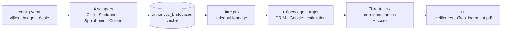

<div align="center">

# 🏠 Chasseur de logement étudiant

**Scrape 4 sites de logement, filtre par budget et temps de trajet, classe les offres
et génère un rapport PDF prêt à lire.**


</div>

---

## ✨ Ce que ça fait

Tu cherches un logement (colocation, studio, chambre, cohabitation intergénérationnelle) autour de ton école,
avec un budget et un temps de trajet maximum. Le programme :

1. **Scrape** quatre sites pour les villes de ta liste : **Cloé**, **Studapart**, **Spotahome** et **Colette**.
2. **Filtre** par prix, **temps de trajet** et **nombre de correspondances** jusqu'à ton école.
3. **Dédoublonne**, **note** chaque offre (prix, distance, confort, éligibilité APL) et garde le **Top 10**.
4. **Génère un PDF** : critères, tableau récapitulatif avec liens cliquables, fiches détaillées avec photos,
   et une section « Aides & Conseils » (Visale, CAF/APL, pièces du dossier).



> ⚠️ **Usage strictement personnel** (chercher *ton* logement). Le programme respecte `robots.txt`, attend 2 à 5 s entre
> les requêtes et ne fait jamais de volume agressif. Il **ne contacte personne** et n'envoie aucune demande sur les sites.

---

## 📋 Prérequis

| Outil | Pourquoi | Obligatoire |
|---|---|---|
| **Python 3.10+** ([python.org](https://www.python.org/downloads/)) | exécuter le programme (testé en 3.12) | ✅ |
| **Google Chrome** (ou Edge) | connexion manuelle à Studapart / Colette | ✅ pour ces 2 sites |
| Compte **Studapart** (portail de ton école) | accéder aux annonces Studapart | optionnel |
| Compte **Colette** (gratuit) | accéder aux annonces Colette | optionnel |
| Clé **PRIM** (gratuite) ou **Google Directions** | temps de trajet réels + correspondances | optionnel, recommandé |

Les sites sont **indépendants** : si un site n'est pas configuré (pas de compte, pas de session), il est simplement
ignoré avec un message clair, et les autres tournent normalement.

---

## 🚀 Installation (5 minutes)

### 1. Récupérer le projet

```bash
git clone https://github.com/<ton-compte>/<ton-depot>.git
cd <ton-depot>
```

### 2. Créer un environnement virtuel (recommandé)

<details open>
<summary><b>Windows (PowerShell)</b></summary>

```powershell
python -m venv .venv
.venv\Scripts\Activate.ps1
```
</details>

<details>
<summary><b>macOS / Linux</b></summary>

```bash
python3 -m venv .venv
source .venv/bin/activate
```
</details>

### 3. Installer les dépendances

```bash
pip install -r requirements.txt
playwright install chromium
```

### 4. Adapter `config.yaml` à ta situation

Ouvre `config.yaml` et change au minimum :

```yaml
ecole:
  nom: "Mon école"
  adresse: "10 Rue Sextius Michel, 75015 Paris"   # ← l'adresse exacte de ton campus

recherche:
  villes:                  # ← les villes où chercher (voir « Ajouter une ville »)
    - "Paris"
    - "Versailles"

filtres:
  prix_min: 500
  prix_max: 700            # budget €/mois
  temps_trajet_max_minutes: 90
  correspondances_max: 3
```

### 5. Premier lancement

```bash
python main.py
```

Sans aucun compte ni clé API, **Cloé** et **Spotahome** fonctionnent déjà : tu obtiens un premier PDF
(`meilleures_offres_logement.pdf`) avec des temps de trajet *estimés*. Les sections suivantes ajoutent les
autres sites et la précision des trajets.

---

## 🔐 Activer Studapart et Colette (connexion manuelle)

Ces deux sites sont derrière une connexion. Un script ouvre un vrai navigateur : **tu te connectes toi-même**, puis il
sauvegarde ta session. **Le programme ne voit, ne demande et ne stocke jamais ton mot de passe.**

```bash
python export_session.py --site studapart
python export_session.py --site colette
```

1. Une fenêtre Chrome s'ouvre sur le site.
2. Connecte-toi (sur **Colette**, crée d'abord un compte gratuit via « Inscription »).
3. Vérifie qu'une page avec des annonces s'affiche.
4. Reviens dans le terminal et appuie sur **Entrée**.

Résultat : `storage_state_studapart.json` et `storage_state_colette.json` (ces fichiers contiennent des cookies de
session : ils sont dans `.gitignore`, **ne les partage jamais**).

> 💡 **Studapart** : règle ta zone et ton budget dans l'interface du site *avant* l'export. Le scraper lit les résultats
> de ta recherche enregistrée, puis filtre sur les villes de `config.yaml`.
>
> 💡 **Session expirée ?** Le programme l'indique (« Session Colette expirée. Veuillez exécuter… ») et continue avec les
> autres sites. Relance simplement la commande ci-dessus.
>
> 💡 **Google bloque la connexion ?** Le script lance ton vrai Chrome sans marqueur d'automatisation justement pour
> ça. Si besoin, ferme toutes tes fenêtres Chrome avant de lancer le script.

---

## 🚇 Temps de trajet réels et correspondances (optionnel mais recommandé)

Sans clé, le trajet est une **estimation grossière** (distance à vol d'oiseau) et le nombre de correspondances est
**« non vérifié »** (l'offre est quand même conservée). Avec une clé, tu as le temps réel en transports en commun
**et** le nombre de correspondances. Le programme essaie, dans l'ordre :

| # | Source | Coût | Couverture | Correspondances |
|---|---|---|---|---|
| 1 | **Google Directions** (mode `transit`) | quota gratuit puis payant, carte bancaire | monde | ✅ |
| 2 | **PRIM** – Île-de-France Mobilités | **gratuit** | Île-de-France | ✅ |
| 3 | OpenRouteService (vélo) | gratuit | monde | ❌ durée seule |
| 4 | Estimation à vol d'oiseau | – | partout | ❌ |

### Option A – PRIM (gratuit, Île-de-France) ✅ conseillé

1. Crée un compte sur [prim.iledefrance-mobilites.fr](https://prim.iledefrance-mobilites.fr).
2. Génère ton **jeton API** (« Mon compte »), puis **abonne-toi** à l'API *Calculateur d'itinéraires
   Île-de-France Mobilités (Navitia)* dans le catalogue.
3. Fournis le jeton via une **variable d'environnement** (jamais dans un fichier du projet) :

```powershell
# Windows (puis ferme et rouvre le terminal)
setx PRIM_API_KEY "ton_jeton"
```
```bash
# macOS / Linux (à mettre dans ~/.bashrc ou ~/.zshrc)
export PRIM_API_KEY="ton_jeton"
```

### Option B – Google Directions API

1. [console.cloud.google.com](https://console.cloud.google.com) → crée un projet et **active la facturation**
   (Google offre un quota mensuel gratuit, vérifie la page de tarifs).
2. « API et services » → Bibliothèque → active **Directions API** (API dite *héritée* : si elle est indisponible sur un
   projet récent, utilise l'option A).
3. « Identifiants » → crée une **clé API**, **restreins-la** à Directions API et crée une **alerte de budget**.
4. Variable d'environnement `GOOGLE_TRANSIT_API_KEY` (ou `api.google_transit_api_key` dans `config.yaml`, déconseillé).

> 🔒 Ne colle jamais une clé dans un chat, un ticket ou un commit. Si ça arrive, régénère-la aussitôt.

---

## ▶️ Utilisation

```bash
python main.py                      # utilise le cache s'il existe, sinon scrape
python main.py --force-rescrape     # ignore le cache et re-scrape tout
python main.py --no-scrape          # régénère le PDF depuis le cache, sans rien scraper
python main.py --sources colette    # ne scrape que ce site (les autres gardent leur cache)
python main.py --debug              # logs détaillés
```

| Option | Effet |
|---|---|
| `--no-scrape` | régénère le PDF depuis `annonces_brutes.json` (rapide, pour tester les filtres) |
| `--force-rescrape` | ignore le cache existant et re-scrape les sites demandés |
| `--sources …` | `cloe`, `studapart`, `spotahome`, `colette` (une ou plusieurs) |
| `--config fichier.yaml` | utiliser une autre configuration |
| `--debug` | niveau de log DEBUG |

Un run complet dure **10 à 20 minutes** (délais de politesse entre les requêtes, géocodage à 1 requête/seconde).
Une source qui échoue **ne supprime pas** ses anciennes données du cache.

### Ce que tu obtiens

| Fichier | Contenu |
|---|---|
| `meilleures_offres_logement.pdf` | le rapport : Top 10, tableau, fiches avec photos, aides & conseils |
| `annonces_brutes.json` | toutes les annonces scrapées (cache, avec la ville d'origine) |
| `scraping.log` | journal : annonces trouvées / rejetées **par ville** et pourquoi |
| `*_debug*.png` | captures d'écran quand un site ne répond pas comme prévu |

---

## 🏙️ Ajouter une ville

Ajoute simplement son nom dans `config.yaml` :

```yaml
recherche:
  villes:
    - "Paris"
    - "Boulogne-Billancourt"   # ← nouvelle ville
```

La liste est une **base de recherche**, pas le filtre final : c'est le **calcul de trajet** qui décide quelles
offres restent. Comportement selon le site :

- **Cloé** : une page par ville. Ville absente ou vide → avertissement, passage à la suivante.
- **Spotahome** : recherche de la ville dans le site. Il n'est pas présent partout → avertissement + capture
  `spotahome_debug_<ville>.png`.
- **Studapart** : pas de suggestion de ville dans leur interface ; tous les résultats de ta recherche enregistrée sont lus puis
  filtrés côté client sur ces villes.
- **Colette** : la recherche renvoie les chambres autour de la ville (une même chambre peut apparaître pour plusieurs villes :
  elle n'est gardée qu'une fois).

---

## ⚖️ Comment les offres sont classées

```
score = w_prix × (1 − prix_norm) + w_distance × (1 − distance_norm)
      + w_confort × confort_norm + w_apl × bonus_apl
```

- `prix_norm`, `distance_norm` : normalisés entre 0 et 1 sur l'ensemble des offres retenues (0 = meilleur).
- `confort_norm` : moyenne pondérée de la surface et de la note (0,5 si la donnée manque), +0,1 si charges comprises.
- `bonus_apl` : 1 si éligible APL détecté, 0,5 si non précisé, 0 si explicitement non éligible.
- Poids réglables dans `config.yaml` → `poids_score` (défaut 0,35 / 0,35 / 0,20 / 0,10).

**Filtre d'acceptation** : prix dans la fourchette **ET** trajet ≤ `temps_trajet_max_minutes` **ET**
(correspondances ≤ `correspondances_max` **OU** correspondances inconnues). Une offre n'est jamais rejetée pour
la seule raison que ses correspondances n'ont pas pu être vérifiées ; le PDF l'indique.

> ℹ️ **Éligibilité APL/CAF** : détectée par mots-clés dans l'annonce, donc **indicative**. « Non précisé » ne veut pas dire
> « Non ». Vérifie toujours avec le [simulateur de la CAF](https://www.caf.fr). Pour **Colette**, il s'agit le plus
> souvent d'une convention d'hébergement (pas d'un bail classique) : éligibilité à vérifier au cas par cas avec la CAF.

---

## 🗂️ Structure du projet

```
├── main.py                  # orchestrateur : scrape → filtre → score → PDF
├── export_session.py        # sauvegarde une session Studapart / Colette (connexion manuelle)
├── config.yaml              # école, villes, budget, filtres, poids, sessions, fichiers
├── requirements.txt
├── scrapers/
│   ├── base_scraper.py      # interface commune, robots.txt, retry/backoff, parsing de prix
│   ├── cloe_scraper.py
│   ├── studapart_scraper.py
│   ├── spotahome_scraper.py
│   └── colette_scraper.py
├── utils/
│   ├── geocoding.py         # Nominatim + trajet (Google / PRIM / estimation)
│   ├── prim_idfm.py         # API PRIM Île-de-France Mobilités
│   ├── apl_detector.py      # détection APL/CAF
│   ├── dedup.py             # doublons (URL ou titre similaire + prix proche)
│   └── scorer.py            # notation et classement
├── pdf/pdf_generator.py     # rapport PDF (ReportLab)
└── tests/                   # tests des parseurs HTML, sans réseau
```

Chaque scraper garde ses **sélecteurs CSS en constantes** en haut du fichier : si un site change sa mise en page,
c'est là qu'il faut corriger. Les fonctions de parsing HTML sont **pures** (HTML en entrée, annonces en sortie) et
testées hors réseau :

```bash
python -m unittest discover tests
```

---

## 🛠️ Dépannage

| Symptôme | Cause probable | Solution |
|---|---|---|
| `Clés manquantes dans config.yaml : …` | une clé a été supprimée | recopie-la depuis `config.yaml` du dépôt |
| `Session … expirée` | cookies périmés | `python export_session.py --site <site>` |
| Studapart : 0 annonce dans mes villes | ta recherche enregistrée ne couvre pas ces villes ou ton budget | règle la zone/budget dans Studapart puis refais l'export |
| Spotahome : « n'est pas présent à … » | le site ne couvre pas cette ville | normal, ignorée avec un avertissement |
| Trajets marqués `~` et « non vérifié » | aucune clé PRIM / Google | voir la section trajets |
| `playwright : browser not found` | navigateur non installé | `playwright install chromium` |
| La fenêtre de connexion tourne sans fin | Google détecte l'automatisation | ferme tes fenêtres Chrome et relance `export_session.py` |
| Un site ne renvoie rien | sa mise en page a changé | regarde `*_debug*.png` et `scraping.log`, ajuste les constantes du scraper |

---

## 🔒 Sécurité et confidentialité

- `storage_state_*.json` (cookies de session), `chrome_profile*/`, `annonces_brutes.json`, `geocache.json`, les PDF,
  les logs et les captures sont **exclus par `.gitignore`**.
- **Aucune clé API dans le dépôt** : utilise les variables d'environnement (`PRIM_API_KEY`, `GOOGLE_TRANSIT_API_KEY`,
  `ORS_API_KEY`).
- Avant un `git push`, vérifie avec `git status` qu'aucun fichier de session ou de résultat n'est suivi.

---

## ⚠️ Limites connues

- **Cloé** : les fiches détaillées ne sont pas accessibles ; les données viennent des listes (titre, prix, adresse, surface).
- **Spotahome** : prix élevés en général, couverture limitée à certaines villes.
- **Studapart / Colette** : leur interface peut changer ; les sélecteurs sont à ajuster dans ce cas.
- Prix des **colocations** : vérifie si le prix affiché est celui de la chambre ou du logement entier.
- Les temps de trajet « estimés » (`~`) ne remplacent pas un vrai calcul d'itinéraire.

---

<div align="center">

Fait pour trouver un logement, pas pour spammer des sites. Sois correct avec eux. 🙂

</div>
